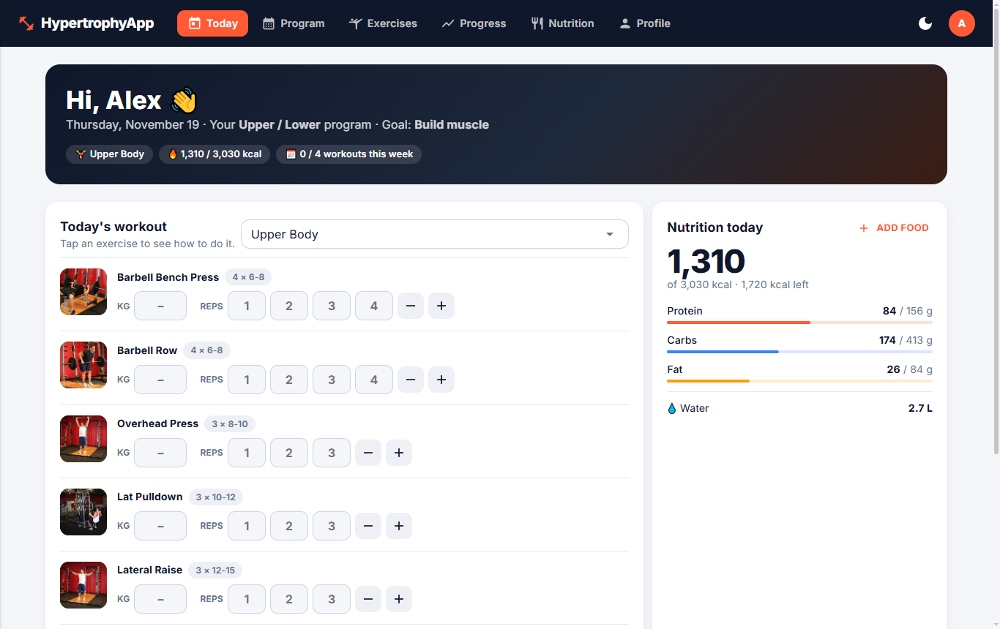
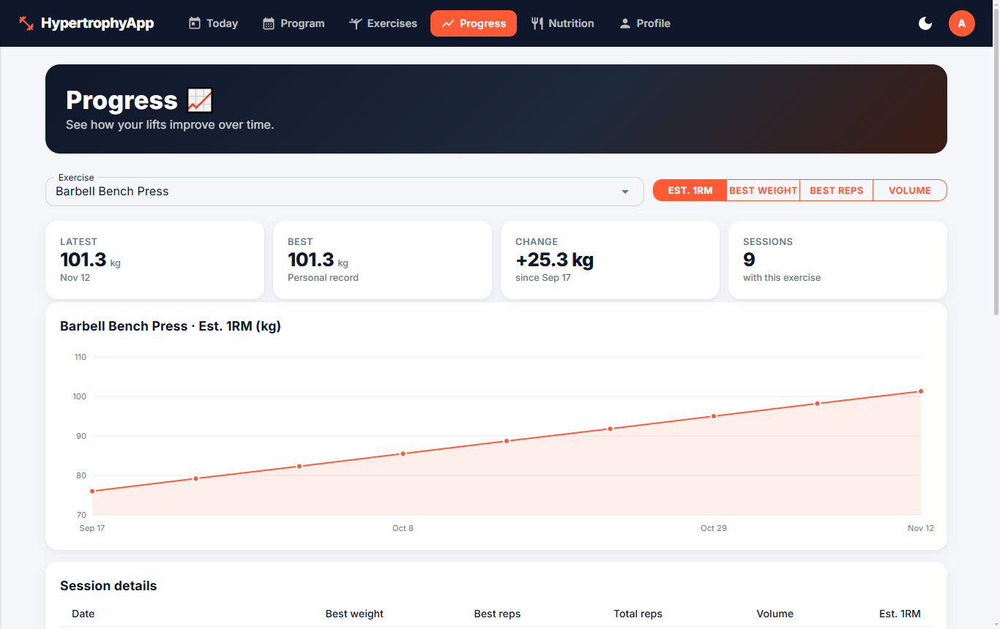
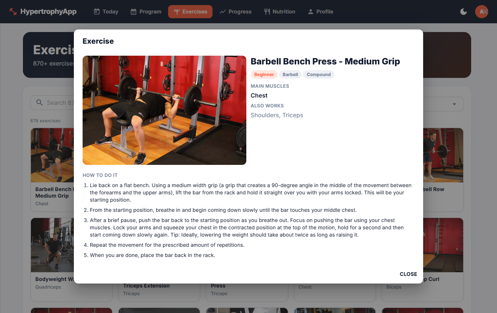
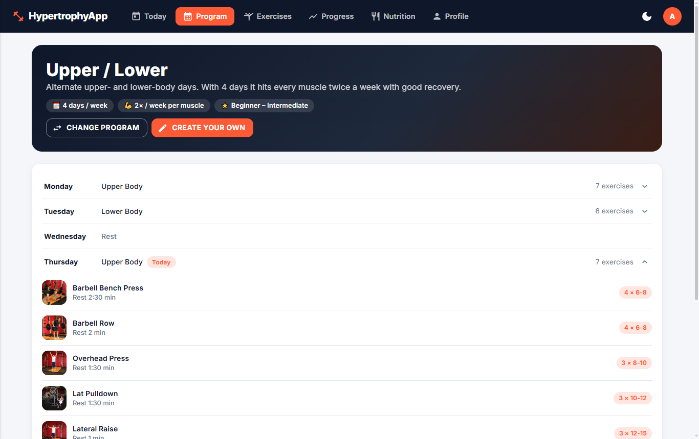
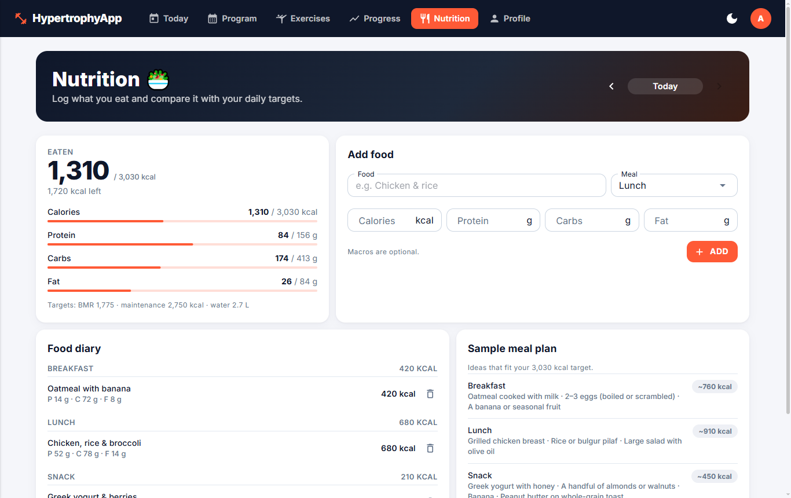
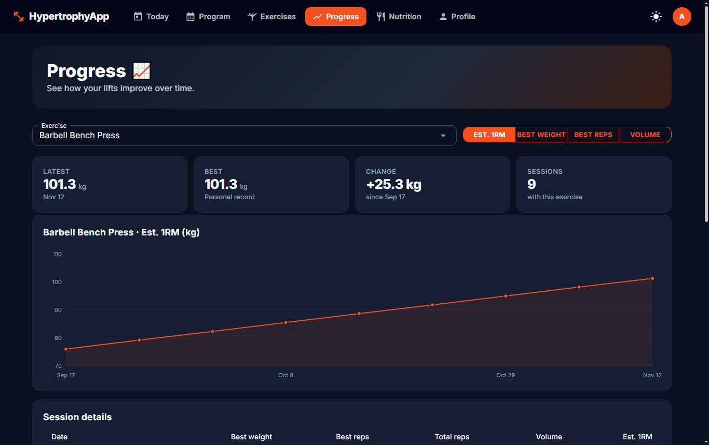
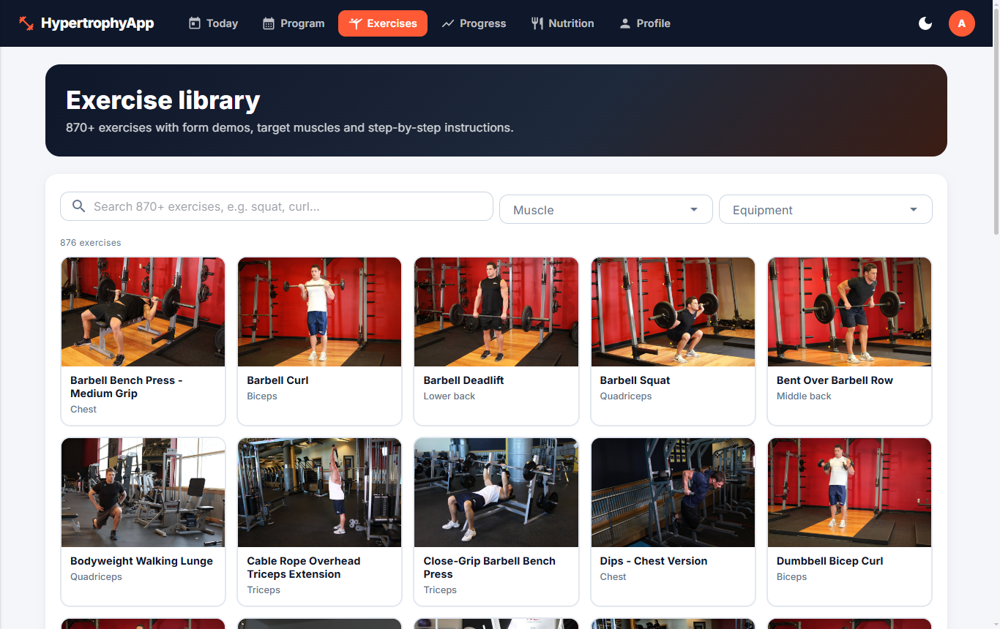
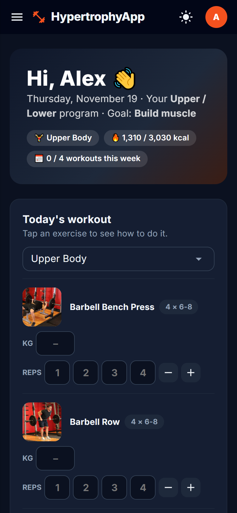
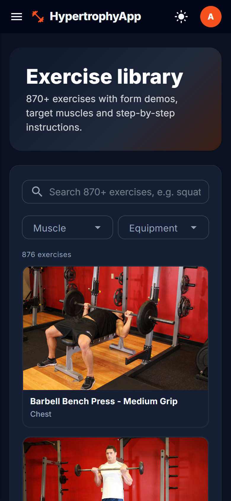
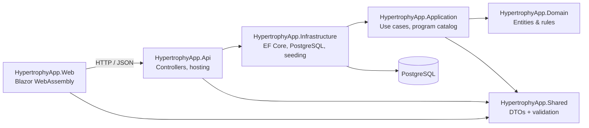

<div align="center">

# 🏋️ HypertrophyApp

**An evidence-based strength training & nutrition tracker, built end-to-end in C# / .NET 10.**

Pick how many days you can train, get a research-backed program, log your sets in seconds,
watch your lifts climb – without ever handing over an e-mail address.

[](https://github.com/vesay/HypertrophyApp/actions/workflows/ci.yml)




</div>

## ✨ Highlights

- **Full-stack .NET, one language end to end** – ASP.NET Core Web API + Blazor WebAssembly, sharing DTOs and
  validation rules through a common contracts library, so the browser and the server can never disagree.
- **Clean Architecture** – Domain → Application → Infrastructure → API, with dependencies pointing inward and the
  domain free of framework code.
- **Real-database integration tests** – the API is booted with `WebApplicationFactory` against a disposable
  PostgreSQL container (Testcontainers), running the actual EF Core migrations. Runs in GitHub Actions on every push.
- **Evidence-based programming** – training splits for 1–6 days a week chosen from resistance-training frequency
  research, plus Mifflin-St Jeor calorie & macro targets.
- **876-exercise library with form demos** – searchable, filterable, and wired into the workout builder.
- **Privacy by design** – no accounts, no e-mail, no password. Just a nickname and the four numbers needed for the
  energy estimate.
- **Hand-built SVG charts**, light & dark themes and a responsive layout that works on a phone at the gym.

## 📸 Screenshots

| Progress (estimated 1RM over time) | Exercise library with form demo |
|---|---|
|  |  |
| **Weekly program** | **Food diary vs. daily targets** |
|  |  |
| **Dark mode** | **Exercise browser** |
|  |  |

<p align="center">
  
  &nbsp;&nbsp;
  
</p>

## 🧩 Features

| Area | What you can do |
|---|---|
| **Onboarding** | Enter a nickname, sex, age, height and weight; choose a goal (lose fat / maintain / build muscle) and 1–6 training days. The recommended split is pre-selected. |
| **Program** | See the weekly schedule with sets, reps and rest times, or build your own program day by day, picking exercises from the library while watching their demo. |
| **Workout log** | One weight box and one reps box per set. Add or remove sets with **+ / −**. Tap any exercise to see how to perform it. |
| **Progress** | Per-exercise charts of estimated 1RM (Epley), best weight, best reps and volume, plus a session table. |
| **Nutrition** | Daily calorie, protein, carb and fat targets, a food diary per meal, and sample meal plans. |
| **Exercise library** | 876 exercises with search, muscle and equipment filters, target muscles and step-by-step instructions. |
| **Profile** | View, edit or permanently delete your profile together with all of its logs. |

## 🛠️ Tech Stack

| Layer | Technology |
|---|---|
| Backend | ASP.NET Core Web API (.NET 10 LTS), ProblemDetails, rate limiting, OpenAPI |
| Frontend | Blazor WebAssembly, MudBlazor, custom SVG charts |
| Data | Entity Framework Core 10, PostgreSQL 17 (jsonb owned types, `text[]` columns, migrations) |
| Testing | xUnit, `WebApplicationFactory`, Testcontainers for PostgreSQL |
| DevOps | Docker Compose, GitHub Actions |

## 🏛️ Architecture



```
src/
  HypertrophyApp.Domain          Entities and domain rules (no dependencies)
  HypertrophyApp.Application     Use cases, program catalog, nutrition calculator, IApplicationDbContext
  HypertrophyApp.Infrastructure  EF Core DbContext, migrations, exercise seed data
  HypertrophyApp.Api             REST controllers; also hosts the Blazor client from a single origin
  HypertrophyApp.Shared          DTOs and validation attributes shared by the API and the client
  HypertrophyApp.Web             Blazor WebAssembly client
tests/
  HypertrophyApp.UnitTests         Domain & application logic (52 tests)
  HypertrophyApp.IntegrationTests  HTTP API against a real PostgreSQL container
```

### Engineering decisions worth a look

- **`Result<T>` instead of exceptions for expected failures** – services return validation / not-found results that a
  base controller maps to RFC 7807 ProblemDetails.
- **One source of validation truth** – request classes in `Shared` carry DataAnnotations used both by the API's
  automatic model validation and by the Blazor forms.
- **Rich PostgreSQL mapping** – a user's custom program is an owned type stored as `jsonb`; exercise muscles and
  instructions are native `text[]` arrays; enums are stored as readable strings.
- **Deterministic seed data** – the exercise library ships as an embedded JSON resource and is seeded idempotently on
  first start; a unit test guarantees every built-in program exercise links to a library entry with images.
- **Single-origin hosting** – the API serves the WebAssembly client, so there is no CORS surface to configure.

## 🔒 Privacy & security

- **No personal data:** no accounts, e-mail, phone number or password. The random profile id lives in the browser's
  `localStorage` and is the only link between a visitor and their data; deleting the profile cascades to all logs.
- **No secrets in the repository:** the only credential is a throw-away default for the local Docker database, which
  is bound to `127.0.0.1`. It can be overridden with a git-ignored `.env` file (see `.env.example`). Outside
  Development there is no connection string at all – it must be provided through configuration
  (e.g. `ConnectionStrings__HypertrophyApp`).
- **Hardening:** per-IP rate limiting on the API, `nosniff` / `X-Frame-Options` / `Referrer-Policy` headers, HSTS
  outside Development, input validation on every request, and server-side ProblemDetails without stack traces.

## 🔬 Evidence-based programming

Training each muscle about twice a week tends to beat once a week, with little extra benefit beyond that when weekly
volume is equal; a single weekly full-body session still works with ~4+ hard sets per muscle.

| Days / week | Recommended split | Each muscle trained | Alternatives |
|---|---|---|---|
| 1 | Full Body (Minimal) | 1× / week | – |
| 2 | Full Body A/B | 2× / week | Upper / Lower |
| 3 | Full Body A/B/C | 3× / week | Push / Pull / Legs |
| 4 | Upper / Lower | 2× / week | Full Body |
| 5 | Upper / Lower + PPL | 2× / week | Bro Split |
| 6 | Push / Pull / Legs ×2 | 2× / week | Arnold Split |

## 🚀 Getting Started

**Requirements:** [.NET 10 SDK](https://dotnet.microsoft.com/download) and [Docker Desktop](https://www.docker.com/products/docker-desktop/).

On Windows, double-click **`start-hypertrophyapp.cmd`**. It starts Docker and PostgreSQL, runs the app and opens
http://localhost:5243. Every new browser starts at onboarding, so each person sets up their own profile.

Or from a terminal on any OS:

```bash
git clone https://github.com/vesay/HypertrophyApp.git
cd HypertrophyApp
docker compose up -d                                   # PostgreSQL 17 on localhost:5432
dotnet run --project src/HypertrophyApp.Api            # API + Blazor client on http://localhost:5243
```

Migrations and the exercise seed run automatically on startup in Development.

### Running the tests

```bash
dotnet test     # unit tests + integration tests (Docker must be running for the latter)
```

## 📡 API

| Method | Route | Description |
|---|---|---|
| GET | `/api/programs/splits?days={1-6}` | Training splits available for a day count |
| POST | `/api/profiles` | Create an anonymous profile |
| GET / PUT / DELETE | `/api/profiles/{id}` | Read, update or delete a profile (and all of its logs) |
| GET | `/api/profiles/{id}/dashboard` | Weekly program + nutrition plan |
| GET / PUT | `/api/profiles/{id}/custom-program` | The user's own workout program |
| GET | `/api/profiles/{id}/sessions` | Workout history |
| GET / PUT / DELETE | `/api/profiles/{id}/sessions/{yyyy-MM-dd}` | Sets logged on a day |
| GET | `/api/profiles/{id}/progress?exercise=` | Per-day best weight, reps, volume, e1RM |
| GET / POST | `/api/profiles/{id}/foods` | Food diary for a day / add an entry |
| DELETE | `/api/profiles/{id}/foods/{entryId}` | Remove a food entry |
| GET | `/api/profiles/{id}/foods/daily-totals?from=&to=` | Daily calorie & macro totals |
| GET | `/api/exercises?q=&muscle=&equipment=&skip=&take=` | Search the exercise library |
| GET | `/api/exercises/filters` | Available muscles and equipment |
| GET | `/api/exercises/{id}` | Exercise details, instructions and images |

## 🗺️ Roadmap

- [x] **v0.1 – Core:** anonymous onboarding, research-based splits, weekly program, nutrition targets
- [x] **v0.2 – Tracking:** set logging, custom programs, progress charts, food diary, light & dark theme
- [x] **v0.3 – Exercise library:** 876 exercises with form demos, search & filters, picker in the program builder
- [x] **v0.3.1 – Quality:** integration tests on real PostgreSQL, CI pipeline, rate limiting & security headers
- [ ] **v0.4 – Deploy:** Dockerfile and a public live demo
- [ ] **v0.5 – Body weight:** weight history chart
- [ ] **v0.6 – AI coach:** LLM-generated programs based on goals and training history

## 🙏 Credits

Exercise data comes from the public-domain [free-exercise-db](https://github.com/yuhonas/free-exercise-db) (Unlicense).
Its start/end position photos are not copied into this repository; they are loaded from the original repository via
jsDelivr and cross-faded into a GIF-like form demo. The dataset states no license for the photos, so a commercial
deployment should point `ExerciseLibrary:ImageBaseUrl` at a licensed media source.

## 📄 License

[MIT](LICENSE)
